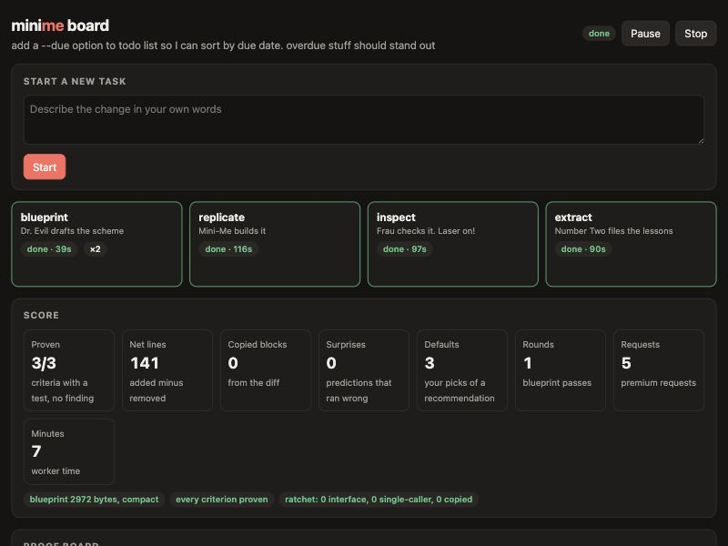
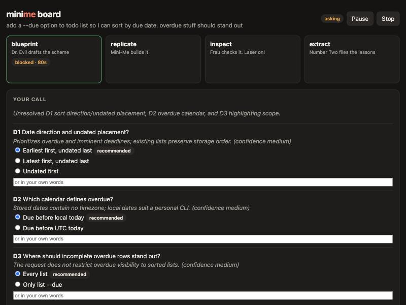
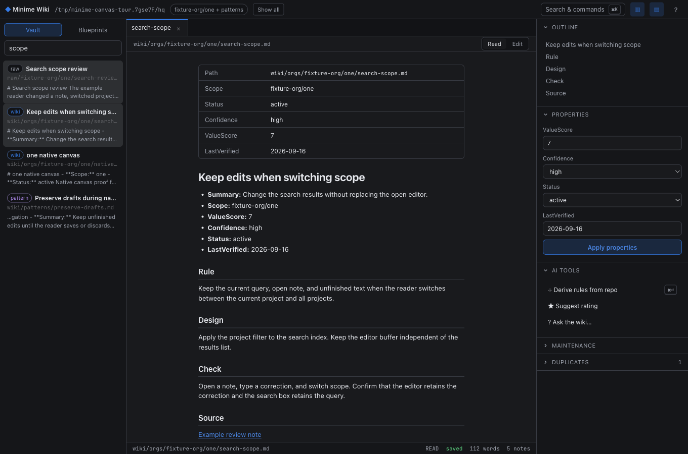
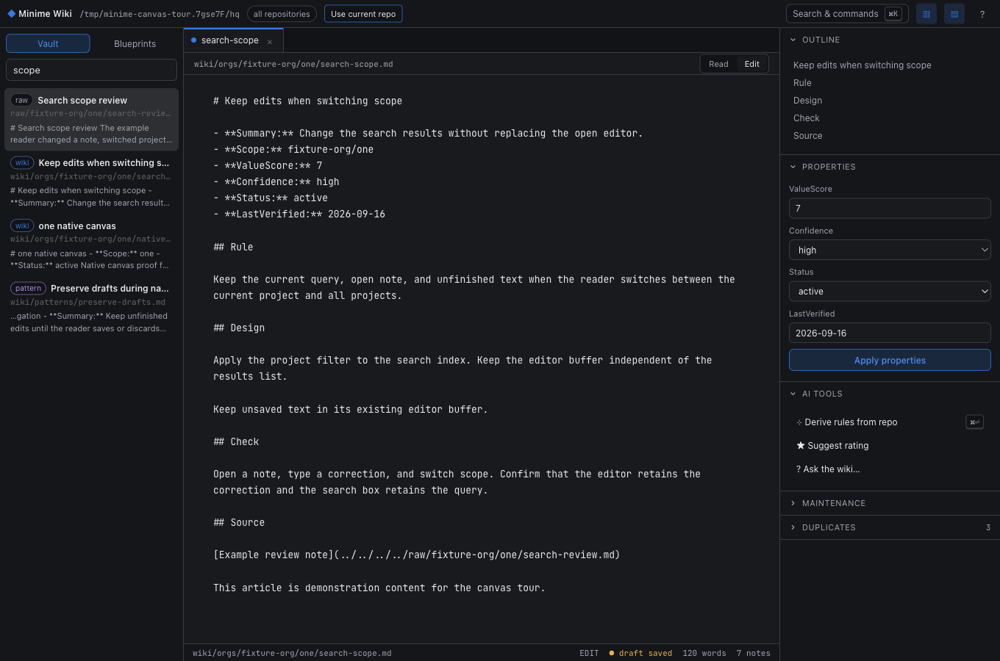

# Canvas tour

Ask Copilot to open the minime board or Minime Wiki. These screenshots show the canvas content with example data and a dark theme.

## Run a task on the board

The minime board (`minime-flow`) is the same page as `node conductor/minime.mjs`: one conductor for the session's repository, with fresh Copilot workers for blueprint, replicate, inspect and extract. Describe the task in your own words and choose **Start**, or ask Copilot to open the board with a task.

- Each phase card shows its worker's latest commands while it runs, then its result and time.
- **Score** counts proven criteria, net lines, copied blocks, surprises, accepted defaults, rounds, requests and minutes.
- **Proof board** lists each criterion with the words it quotes, the evidence it rests on, its tests and its state.
- **Boundaries** draws the blueprint's owners as boxes. Click a box to read it. While no worker runs, edit owners, contracts, changes and the criteria they serve, then choose **Save to blueprint**. A save that breaks `check` is refused with the errors.
- **Tell Dr. Evil** sends a correction or a follow-up. It applies after the running worker; a follow-up after the run starts a new, usually small round.
- **Pause** waits before the next worker; **Stop** stops the workers. Closing the canvas stops them too.

When the blueprint needs your call, the board asks. The recommendation is preselected; keeping it records the decision as `default:`, choosing another option or writing your own records it as yours.

## Search the wiki

Search and open a result. Choose **Show all** to include every project. **Use current repo** restores this project's notes plus shared patterns.

## Edit a wiki article

Choose **Edit** to change the Markdown. The canvas saves a draft as you type; press **Cmd/Ctrl+S** or choose **Save note** in **Search & commands** to update the article.

Save the article before changing **Properties**, then choose **Apply properties**. You cannot edit raw sources or blueprints here. For a blueprint listed in the wiki, choose **Open in the minime board** and send changes as feedback.

See [Canvas guidance](../assets/CANVAS.md) for agent behavior.
